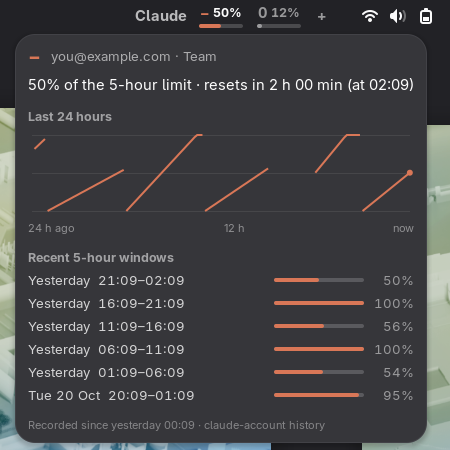
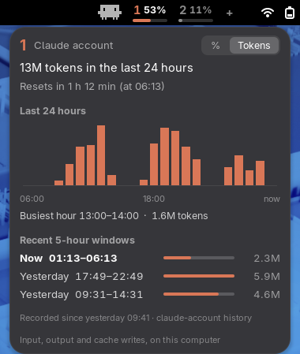
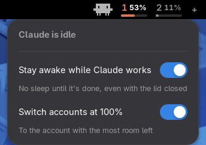
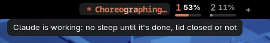

<p align="center"></p>

<h1 align="center">Claude Account Switcher</h1>

<p align="center">Switch <a href="https://docs.anthropic.com/en/docs/claude-code">Claude Code</a> between two (or more) accounts with one click in the GNOME top bar,<br>
without restarting, and see how much of each account's 5-hour limit is used.</p>

<p align="center"></p>

> **Unofficial.** This project is not made by, affiliated with, or endorsed by Anthropic.
> It relies on how Claude Code stores its login on Linux, which can change in any release.
> Make sure the way you use multiple accounts complies with Anthropic's terms.

## What it does

- **One-click switching.** Click an account in the top bar. A Claude Code session that is
  already running picks up the new login on its next message, so you keep the same chat
  with its full history. No `/login`, no restart.
- **Live usage.** Each account shows its 5-hour usage in percent, refreshed every minute.
  The selected account has an orange bar, the other a grey one.
- **Reset time.** Hover an account to see when its limit resets.
- **% or tokens.** The history panel switches between both with one click: the 5-hour
  window, each hour of the last 24 and each recent window, in percent of the limit or in tokens.
- **Automatic switch at 100%.** When the account you're on reaches its 5-hour limit, it
  switches to the signed-in account with the most room left and tells you in a notification.
- **Usage history.** Click the account you're on (or right-click any account) for how much
  each of the last 24 hours used (hover a bar for its numbers) and its recent 5-hour windows
  with how high each one went.
- **Add accounts from the top bar.** Click **+**, type a name (anything short: `2`, `work`,
  `-`), and sign in in a **private window**, so your browser can't quietly reuse the Claude
  account it's already logged in to. Once you're in, that account becomes active.
- **Shows when Claude is working.** Claude Code's mascot sits in the top bar while Claude is
  idle; while it works, Claude Code's own spinner takes its place (see below).
- **No sleep while Claude works.** Close the lid mid-task and the laptop keeps going until
  Claude is done, then does what closing the lid normally does.
- **A CLI too.** Everything works from the terminal with `claude-account`.

<p align="center"> </p>

## Options

Click the mascot (or right-click it) to turn either feature off or back on. Both are on by default.

<p align="center"></p>

- **Stay awake while Claude works:** see [While Claude works](#while-claude-works).
- **Switch accounts at 100%:** checked with every usage update (once a minute). It only moves
  to an account that is signed in and under its limit; if they're all full, it stays. The
  chat you're in continues on the new account with your next message.

From the terminal: `claude-account keep-awake on|off` and `claude-account auto-switch on|off`.

## While Claude works

<p align="center"></p>

As soon as you send Claude Code a message, the spinner from your terminal takes the
mascot's place: the same cycling star, the same orange with its moving glimmer, and a word
from Claude Code's own list of 187, a new one each time Claude starts working and every
3 minutes on long work (your `spinnerVerbs` setting counts too). They come in random order,
and you see every word once before any comes back; the order carries on after a restart. When Claude is done, or waiting for you, the mascot
comes back.

The word is picked separately from the one in your terminal, so the two usually differ:
Claude Code doesn't tell other programs which word it chose. The terminal also shows states
only Claude Code itself can see, from the reply as it streams in: amber and "thinking" while
Claude thinks, red when the reply stalls. The top bar shows the part that is known from
outside: whether Claude is working at all.

Meanwhile the computer doesn't go to sleep:

- **Idle:** GNOME's automatic suspend waits. The screen can still dim and lock as usual.
- **Lid closed:** the laptop stays on and Claude keeps working. Once the last session is
  done, the lid's normal action runs (suspend, by default), so a laptop in a bag doesn't
  stay awake for nothing.
- Choosing **Suspend** or **Power Off** yourself still works right away.

<p align="center"></p>

This comes from `claude-busy`, a small shell script that Claude Code's
[hooks](https://docs.anthropic.com/en/docs/claude-code/hooks) call: when you send a message
and around each tool call it marks the session as working (one tiny file per session in
`$XDG_RUNTIME_DIR/claude-busy`), and when Claude stops, or has been waiting for you for a
minute, it clears it. While any session is working, one background `claude-busy hold` keeps
two inhibitors (`systemd-inhibit --what=handle-lid-switch` and
`gnome-session-inhibit --inhibit suspend`) and checks every 5 seconds whether it's still
needed. A session whose `claude` process is gone, or that has had no activity for 20 minutes
(for example after you stop it with Esc), counts as done. `claude-busy status` shows what's
working.

It's light: a hook call takes about 5 ms, nothing runs while Claude is idle, and the top bar
reacts to files appearing and disappearing instead of polling. The spinner redraws a short
label every 120 ms only while Claude works.

## The 5-hour window, and tokens

A 5-hour window starts with the first message you send after the previous one has ended,
and lasts 5 hours. The percentage is how much of that window's limit you've used; at the
end it goes back to 0. If you haven't used an account since its window ended, there is no
window running: the next one starts with your next message, so the last window listed can
have ended a while ago. The panel marks the window that's running as **Now**, and
an account whose window has ended shows 0% and *Limit reset at …*.

Anthropic only reports the percentage; switch the history panel to **Tokens** to see those
instead (it remembers your choice). Tokens are counted from Claude Code's own
transcripts on this computer (`~/.claude/projects`): input, output and cache writes, without
cache reads, which are cheap and would dwarf everything else. Each message counts toward the
account that was active when it was sent. Claude Code on other computers isn't included, and
tokens are only known from the first usage check after installing. They're saved in
`~/.claude/accounts/tokens.cache` (8 days, per 10 minutes); reading the transcripts takes
about a second the first time, then a few milliseconds a minute.

## How it works

Claude Code on Linux keeps its login in `~/.claude/.credentials.json`, and a running
session reloads that file when it changes. `claude-account` keeps a copy of each account's
login in `~/.claude/accounts/` and swaps the right one into place when you switch. Any
tokens Claude Code refreshed in the meantime are saved back first.

Usage numbers come from the same endpoint Claude Code's `/usage` command reads. The first
message after a switch costs a bit more on the new account, because it has to read the
whole conversation once. After that, usage is normal.

## Install

Needs Linux, `python3`, Claude Code, and GNOME Shell 45 or newer for the top-bar part
(tested on GNOME 50 / Fedora 44). The CLI works without GNOME.

```bash
git clone https://github.com/aimanelahssini/claude-account-switcher
cd claude-account-switcher
./install.sh
```

The installer also adds the `claude-busy` hooks to `~/.claude/settings.json` (your other
settings and hooks stay as they are); Claude Code sessions started after that use them.

If Claude Code is already logged in, the installer saves that login as account **1**
(rename it with `claude-account rename 1 NAME`). Log out and back in once so GNOME loads the
extension, then click **+** in the top bar to add your other account under any name.
Accounts listed but not signed in yet say *sign in*; clicking one opens the same choice:

<p align="center"></p>

From the terminal, `claude-account add NAME --private` does the same with the name you type.

## Usage

| Command | What it does |
|---|---|
| `claude-account switch 2` | Make account `2` active (same as clicking it) |
| `claude-account current` | Print the active account |
| `claude-account list` | List saved accounts |
| `claude-account usage` | Fetch 5-hour usage for every account |
| `claude-account history [NAME]` | Recent 5-hour windows, how high each went, and their tokens |
| `claude-account auto-switch on\|off` | Switch accounts automatically at 100% (on by default) |
| `claude-account keep-awake on\|off` | Keep the computer awake while Claude works (on by default) |
| `claude-busy status` | Which Claude Code sessions are working right now |
| `claude-account add NAME --private` | Sign in to an account in a private browser window |
| `claude-account add NAME --current` | Save the login Claude Code is using right now |
| `claude-account rename OLD NEW` | Rename an account |
| `claude-account remove NAME` | Forget an account's login |

Avoid running `/login` inside Claude Code after setup: it changes the login behind the
switcher's back. If an account stops working, run `claude-account add NAME` again.

## Privacy

Everything stays on your machine. Usage history is a small file,
`~/.claude/accounts/history.jsonl` (a reading per account at most every 10 minutes unless it
changes, kept 30 days). Anthropic only reports the current number, so history starts when
you install. Saved logins live in `~/.claude/accounts/` with
owner-only permissions (`0600`). The only network calls go to Anthropic: the usage endpoint,
and the token endpoint to renew an account that hasn't been used for a while.

## Uninstall

```bash
./uninstall.sh
```

It removes the extension, `claude-account`, `claude-busy` and their Claude Code hooks, and
leaves every other setting alone. Your saved logins stay in `~/.claude/accounts`; delete
that folder too to forget them.

## License

MIT
