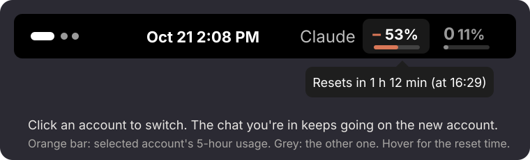
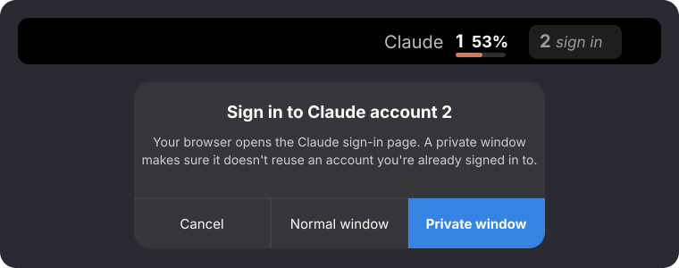

<p align="center"></p>

<h1 align="center">Claude Account Switcher</h1>

<p align="center">Switch <a href="https://docs.anthropic.com/en/docs/claude-code">Claude Code</a> between two (or more) accounts with one click in the GNOME top bar,<br>
without restarting, and see how much of each account's 5-hour limit is used.</p>

<p align="center"></p>

> **Unofficial.** This project is not made by, affiliated with, or endorsed by Anthropic.
> It relies on how Claude Code stores its login on Linux, which can change in any release.
> Make sure the way you use multiple accounts complies with Anthropic's terms.

## What it does

- **One-click switching.** Click an account in the top bar. A Claude Code session that is
  already running picks up the new login on its next message, so you keep the same chat
  with its full history. No `/login`, no restart.
- **Live usage.** Each account shows its 5-hour usage in percent, refreshed every minute.
  The selected account has an orange bar, the other a grey one.
- **Reset time.** Hover an account to see when its limit resets.
- **Sign in from the top bar.** An account you haven't signed in to yet says *sign in*.
  Click it and choose a **private window**, so your browser can't quietly reuse the
  Claude account it's already logged in to. Once you're in, that account becomes active.
- **A CLI too.** Everything works from the terminal with `claude-account`.

## How it works

Claude Code on Linux keeps its login in `~/.claude/.credentials.json`, and a running
session reloads that file when it changes. `claude-account` keeps a copy of each account's
login in `~/.claude/accounts/` and swaps the right one into place when you switch. Any
tokens Claude Code refreshed in the meantime are saved back first.

Usage numbers come from the same endpoint Claude Code's `/usage` command reads. The first
message after a switch costs a bit more on the new account, because it has to read the
whole conversation once. After that, usage is normal.

## Install

Needs Linux, `python3`, Claude Code, and GNOME Shell 45 or newer for the top-bar part
(tested on GNOME 50 / Fedora 44). The CLI works without GNOME.

```bash
git clone https://github.com/aimanelahssini/claude-account-switcher
cd claude-account-switcher
./install.sh
```

The installer sets up two accounts, **1** and **2**. If Claude Code is already logged in,
that login becomes account 1. Log out and back in once so GNOME loads the extension, then
click **2 · sign in** in the top bar:

<p align="center"></p>

Want other names or more accounts? `claude-account init A B C` on a fresh setup, or
`claude-account add NAME --private` at any time.

## Usage

| Command | What it does |
|---|---|
| `claude-account switch 2` | Make account `2` active (same as clicking it) |
| `claude-account current` | Print the active account |
| `claude-account list` | List saved accounts |
| `claude-account usage` | Fetch 5-hour usage for every account |
| `claude-account add NAME --private` | Sign in to an account in a private browser window |
| `claude-account add NAME --current` | Save the login Claude Code is using right now |
| `claude-account remove NAME` | Forget an account's login |

Avoid running `/login` inside Claude Code after setup: it changes the login behind the
switcher's back. If an account stops working, run `claude-account add NAME` again.

## Privacy

Everything stays on your machine. Saved logins live in `~/.claude/accounts/` with
owner-only permissions (`0600`). The only network calls go to Anthropic: the usage endpoint,
and the token endpoint to renew an account that hasn't been used for a while.

## Uninstall

```bash
gnome-extensions disable claude-account-switcher@aimanelahssini
rm -rf ~/.local/share/gnome-shell/extensions/claude-account-switcher@aimanelahssini
rm ~/.local/bin/claude-account
rm -rf ~/.claude/accounts   # deletes the saved logins
```

## License

MIT
